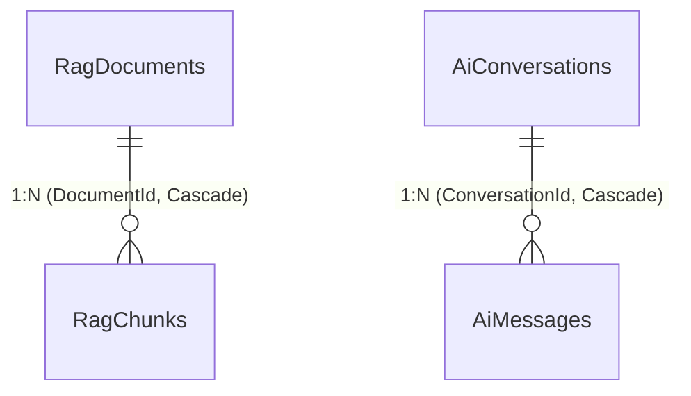

# FPT Alumni Connect — AI Service (`f-alumni-ai-service`)

Dịch vụ Trí tuệ Nhân tạo & Cố vấn Học tập thuộc hệ thống **FPT Alumni Connect** (PRN232 Final Assignment). Được xây dựng theo chuẩn kiến trúc 3 tầng `.NET 10` (`Api -> Services -> Repositories`), ứng dụng kỹ thuật **Retrieval-Augmented Generation (RAG)** kết hợp tìm kiếm ngữ nghĩa tăng cường (Lexical + Intent Boosting), trích dẫn nguồn thực tế, quản lý hội thoại đa lượt, tích hợp Google Gemini API linh hoạt, bộ tổng hợp cục bộ dự phòng (Local Grounded Synthesizer), và thuật toán gợi ý cố vấn (Mentor Recommendation).

- **Owner**: Vinh (`vinhmt` — Backend 2)
- **Cổng dịch vụ (Service Port)**: `http://localhost:5004` (Cổng HTTPS: `https://localhost:7004`)
- **Database**: `FAlumni_AiService_Db` / `FAlumni_AI_Db` (Độc lập 100% — Zero Cross-Database Foreign Keys)
- **Tài liệu ERD Database**: [`docs/ERD.md`](docs/ERD.md)
- **Tài liệu Kiến trúc Hệ thống**: [`docs/ARCHITECTURE.md`](docs/ARCHITECTURE.md) | [`docs/architecture/f-alumni-be2-architecture.svg`](docs/architecture/f-alumni-be2-architecture.svg)

---

## 🗄️ Sơ Đồ ERD Cơ Sở Dữ Liệu (`FAlumni_AiService_Db`)



> Chi tiết đầy đủ 6 thực thể (`RagDocuments`, `RagChunks`, `AiConversations`, `AiMessages`, `MentorProfiles`, `SampleItems`), kiểu dữ liệu và chỉ mục xem tại [`docs/ERD.md`](docs/ERD.md).

---

## 🚀 Toàn Bộ Danh Sách API Endpoints & Nghiệp Vụ Thực Tế

Khớp chính xác 100% với các Controllers trong `src/AiService.Api/Controllers/`:

| Nhóm chức năng | Phương thức HTTP | Đường dẫn Endpoint | Nghiệp vụ chi tiết | Xác thực (Authentication / Authorization) |
| :--- | :--- | :--- | :--- | :--- |
| **Hỏi đáp AI (AI-01..04)** | `POST` | `/api/v1/ai/chat` | Hỏi đáp AI về kinh nghiệm học tập FPTU, RAG trích dẫn tài liệu thực tế, tiếp tục phiên hội thoại đa lượt (`conversationId`). | `Bearer JWT (Optional)` / Guest GUID Fallback (`11111111-1111-1111-1111-111111111111`) |
| **Lịch sử hội thoại** | `GET` | `/api/v1/ai/conversations/{id:guid}` | Lấy chi tiết phiên trò chuyện và toàn bộ lịch sử tin nhắn hỏi đáp. | `Bearer JWT (Optional)` / Guest GUID Fallback |
| **Danh sách hội thoại** | `GET` | `/api/v1/ai/conversations` | Lấy danh sách tất cả các phiên hội thoại của người dùng hiện tại. | `Bearer JWT (Optional)` / Guest GUID Fallback |
| **Nạp tri thức RAG** | `POST` | `/api/v1/ai/rag/ingest` | Nạp hoặc tái lập chỉ mục (Re-index) kho tài liệu Word `.docx` từ thư mục nội bộ. | `Public / Internal Maintenance` |
| **Gợi ý Mentor** | `POST` | `/api/v1/ai/mentors/recommend` | Gợi ý danh sách cựu sinh viên cố vấn theo ngành (`Major`), kỹ năng (`TargetSkills`) và mục tiêu nghề nghiệp (`CareerGoal`). | `Public` (Không yêu cầu đăng nhập) |
| **Sample Items** | `GET` | `/api/v1/sample-items` | Lấy toàn bộ danh sách tài nguyên mẫu. | `AllowAnonymous` |
| **Sample Items** | `GET` | `/api/v1/sample-items/paged` | Lấy danh sách tài nguyên mẫu có phân trang (`pageNumber`, `pageSize`) và tìm kiếm (`search`). | `AllowAnonymous` |
| **Sample Items** | `GET` | `/api/v1/sample-items/{id:guid}` | Lấy thông tin chi tiết một tài nguyên mẫu theo định danh GUID. | `AllowAnonymous` |
| **Sample Items** | `POST` | `/api/v1/sample-items` | Tạo mới tài nguyên mẫu vào hệ thống. | `Authorize(Roles = "USER,ADMIN")` |
| **Sample Items** | `PUT` | `/api/v1/sample-items/{id:guid}` | Cập nhật thông tin tài nguyên mẫu theo GUID. | `Authorize(Roles = "USER,ADMIN")` |
| **Sample Items** | `DELETE` | `/api/v1/sample-items/{id:guid}` | Xóa tài nguyên mẫu khỏi hệ thống. | `Authorize(Roles = "ADMIN")` |
| **Sample Items** | `GET` | `/api/v1/sample-items/admin-only` | Endpoint kiểm tra phân quyền độc quyền cho quản trị viên. | `Authorize(Roles = "ADMIN")` |
| **Sample Items** | `GET` | `/api/v1/sample-items/me` | Trích xuất và xác thực thông tin tài khoản người dùng từ Claims token. | `Authorize` (Đăng nhập hợp lệ) |
| **Health Check** | `GET` | `/health` | Kiểm tra tình trạng hoạt động (Liveness/Readiness) của dịch vụ. | `Public` |
| **OpenAPI Docs** | `GET` | `/openapi/v1.json` | Cung cấp tài liệu OpenAPI / Swagger JSON chuẩn hóa. | `Public (Development)` |

---

## 📡 Tích Hợp Hợp Đồng Sự Kiện Kafka (Event Contracts)

AI Service quản lý và tiêu thụ các hợp đồng sự kiện chia sẻ miền theo chuẩn hash SHA-256 (`scripts/verify-contracts.ps1`):

- **Hợp đồng miền tiêu thụ**: `events/post-created/v1`
  - **Mã sự kiện**: `PostCreatedEventV1` đóng gói trong phong bì `EventEnvelope<PostCreatedEventV1>`.
  - **Topic Kafka**: `falumni.forum.posts` / `post.created.v1`.
  - **Xử lý nghiệp vụ**: Khi người dùng hoặc cựu sinh viên đăng tải bài viết chia sẻ kinh nghiệm trên Forum Service, AI Service tự động tiếp nhận qua `IRagIngestionService.IngestForumPostAsync`, lập chỉ mục vào `RagDocuments` (Loại `ForumPost`) và `RagChunks` (`post_{postId}`) để cập nhật tri thức RAG theo thời gian thực mà không cần nạp lại tài liệu thủ công.

---

## ⚙️ Cấu Hình Khóa Bí Mật & Thay Đổi Model LLM (Không Hardcode)

> 💡 **Khẳng định bảo mật**: Toàn bộ source code C# **tuyệt đối không hardcode API Key, Model name hay chuỗi bí mật**. Mọi giá trị đều được inject qua `IConfiguration` theo thứ tự ưu tiên: `Environment Variables` > `appsettings.json` > `User Secrets`.

```json
// src/AiService.Api/appsettings.json
{
  "ConnectionStrings": {
    "DefaultConnection": "Server=localhost\\SQLEXPRESS;Database=FAlumni_AiService_Db;Trusted_Connection=True;TrustServerCertificate=True;"
  },
  "Jwt": {
    "Issuer": "https://identity.falumni.local",
    "Audience": "falumni-services",
    "Key": "",
    "ClockSkewMinutes": 1
  },
  "Gemini": {
    "ApiKey": "",
    "Model": "gemini-1.5-flash"
  },
  "Rag": {
    "DataDirectory": "data/rag",
    "MaxCitations": 5
  }
}
```

### 1. Cách Thay Đổi Model AI (Không Cần Sửa Code C#)
Khi Google cập nhật model mới hoặc bạn muốn chuyển đổi model, chỉ cần đổi giá trị trong `appsettings.json` hoặc truyền biến môi trường:
- Đổi sang Gemini 2.0 Flash: sửa `"Model": "gemini-2.0-flash"`
- Đổi sang Gemini 1.5 Pro: sửa `"Model": "gemini-1.5-pro"`
- Hoặc đặt biến môi trường:
  ```powershell
  $env:Gemini__Model = "gemini-2.0-flash"
  ```

### 2. Cách Điền API Key Gemini
- **Cách 1 (Biến môi trường - Khuyên dùng)**:
  ```powershell
  $env:GEMINI_API_KEY = "AIzaSy..."
  ```
- **Cách 2 (.NET User Secrets - Khi phát triển cục bộ)**:
  ```powershell
  dotnet user-secrets set "Gemini:ApiKey" "AIzaSy..." --project src/AiService.Api
  ```
- **Cách 3 (appsettings.json)**: Điền trực tiếp vào `Gemini.ApiKey`.

> 🛡️ **Cơ chế Fallback thông minh (Zero-Downtime Guarantee)**:  
> Nếu bạn **không cung cấp API Key**, hoặc gặp lỗi kết nối internet/hết quota Google, AI Service **không bị sập hay báo lỗi**. Hệ thống tự động chuyển sang **Local Grounded Synthesizer**, sử dụng trực tiếp trích đoạn tri thức FPTU đã lập chỉ mục để tạo câu trả lời chính xác, kèm danh sách nguồn trích dẫn đầy đủ.

---

## 🛠️ Hướng Dẫn Chạy & Kiểm Thử Tự Động

```powershell
# 1. Xác minh tính toàn vẹn hợp đồng SHA-256
pwsh -ExecutionPolicy Bypass -File .\scripts\verify-contracts.ps1 -Path .

# 2. Chạy toàn bộ Unit & Integration Tests (Bao gồm test nạp dữ liệu Word thực tế)
dotnet test AiService.sln --configuration Release

# 3. Khởi chạy dịch vụ cục bộ trên cổng 5004
dotnet run --project src/AiService.Api/AiService.Api.csproj
```
