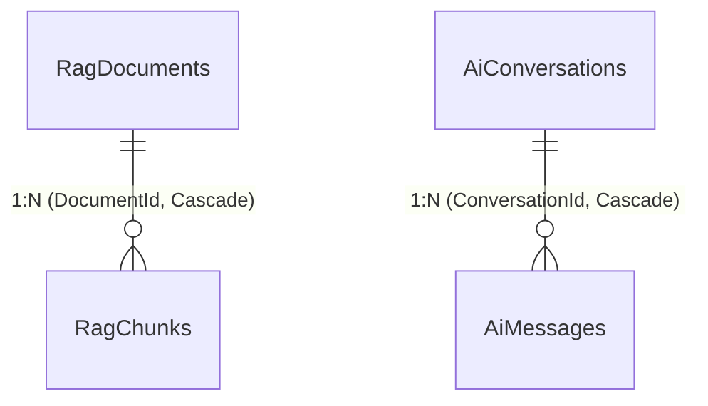

# FPT Alumni Connect — AI Service (`f-alumni-ai-service`)

Dịch vụ Trí tuệ Nhân tạo & Cố vấn Học tập thuộc hệ thống **FPT Alumni Connect** (PRN232 Final Assignment). Được xây dựng theo chuẩn kiến trúc 3 tầng `.NET 10` (`Api -> Services -> Repositories`), ứng dụng kỹ thuật **Retrieval-Augmented Generation (RAG)** kết hợp tìm kiếm ngữ nghĩa tăng cường (Lexical + Intent Boosting `/boost`), trích dẫn nguồn thực tế, quản lý hội thoại đa lượt, tích hợp Google Gemini API (`gemini-2.5-flash`), bộ tổng hợp cục bộ dự phòng (Local Grounded Synthesizer), và thuật toán gợi ý cố vấn (Mentor Recommendation).

- **Owner**: Vinh (`vinhmt` — Backend 2)
- **Cổng dịch vụ (Service Port)**: `http://localhost:5004` (Cổng HTTPS: `https://localhost:7004`)
- **Database**: `FAlumni_AiService_Db` (Độc lập 100% — Zero Cross-Database Foreign Keys)
- **Tài liệu ERD Database**: [`docs/ERD.md`](docs/ERD.md)
- **Tài liệu Kiến trúc Hệ thống**: [`docs/ARCHITECTURE.md`](docs/ARCHITECTURE.md) | [`docs/architecture/f-alumni-be2-architecture.svg`](docs/architecture/f-alumni-be2-architecture.svg)

---

## 🗄️ Sơ Đồ ERD Cơ Sở Dữ Liệu (`FAlumni_AiService_Db`)



> Chi tiết đầy đủ 6 thực thể (`RagDocuments`, `RagChunks`, `AiConversations`, `AiMessages`, `MentorProfiles`, `SampleItems`), kiểu dữ liệu và chỉ mục xem tại [`docs/ERD.md`](docs/ERD.md).

---

## 🚀 Toàn Bộ Danh Sách API Endpoints & Nghiệp Vụ Thực Tế

Khớp chính xác 100% với các Controllers trong `src/AiService.Api/Controllers/`:

| Nhóm chức năng | Phương thức HTTP | Đường dẫn Endpoint | Nghiệp vụ chi tiết | Xác thực (Authentication / Authorization) |
| :--- | :--- | :--- | :--- | :--- |
| **Hỏi đáp AI (AI-01..04)** | `POST` | `/api/v1/ai/chat` | Hỏi đáp AI về kinh nghiệm học tập FPTU, RAG trích dẫn tài liệu thực tế, kế thừa ngữ cảnh & chuyên ngành cho hội thoại đa lượt (`conversationId`). | `Bearer JWT (Optional)` / Guest GUID Fallback (`11111111-1111-1111-1111-111111111111`) |
| **Lịch sử hội thoại** | `GET` | `/api/v1/ai/conversations/{id:guid}` | Lấy chi tiết phiên trò chuyện và toàn bộ lịch sử tin nhắn hỏi đáp kèm trích dẫn (`citations`). | `Bearer JWT (Optional)` / Guest GUID Fallback |
| **Danh sách hội thoại** | `GET` | `/api/v1/ai/conversations` | Lấy danh sách tất cả các phiên hội thoại của người dùng hiện tại. | `Bearer JWT (Optional)` / Guest GUID Fallback |
| **Nạp tri thức RAG** | `POST` | `/api/v1/ai/rag/ingest` | Nạp hoặc tái lập chỉ mục (`forceReindex: true`) kho 12 tài liệu Word `.docx` từ thư mục `data/rag`. | `Public / Internal Maintenance` |
| **Chẩn đoán `/boost` (GET)** | `GET` | `/boost`<br>`/boost/test`<br>`/api/v1/ai/boost`<br>`/api/v1/ai/boost/test` | Kiểm tra trực tiếp quá trình tách từ khóa, nhận diện intent, chuẩn hóa cơ sở/ngành học và bảng xếp hạng điểm RAG (`q`, `query`, `major`, `programCode`, `campus`, `topK`). | `Public` |
| **Chẩn đoán `/boost` (POST)** | `POST` | `/boost`<br>`/api/v1/ai/boost` | Kiểm tra Intent Boosting bằng JSON payload (`{ query, major, programCode, campus, topK }`). | `Public` |
| **Gợi ý Mentor** | `POST` | `/api/v1/ai/mentors/recommend` | Gợi ý danh sách cựu sinh viên cố vấn theo ngành (`Major`), kỹ năng (`TargetSkills`) và mục tiêu nghề nghiệp (`CareerGoal`). | `Public` |
| **Sample Items** | `GET` | `/api/v1/sample-items`<br>`/api/v1/sample-items/paged`<br>`/api/v1/sample-items/{id:guid}` | API mẫu lấy danh sách, phân trang và chi tiết tài nguyên. | `AllowAnonymous` |
| **Sample Items (Auth)** | `POST` / `PUT` / `DELETE` | `/api/v1/sample-items`<br>`/api/v1/sample-items/{id:guid}` | Tạo, cập nhật (`USER,ADMIN`) và xóa (`ADMIN`) tài nguyên mẫu. | `Authorize` |
| **Health & OpenAPI** | `GET` | `/health`<br>`/openapi/v1.json` | Kiểm tra trạng thái hoạt động và tài liệu OpenAPI (Development). | `Public` |

---

## 🧠 Cơ Chế RAG, Intent Boosting (`/boost`) & Gemini Multi-Turn

1. **Tự động nạp tri thức khi khởi động (`RagStartupWorker`)**:
   - Đóng gói sẵn 12 tài liệu `.docx` chuẩn của Đại học FPT trong `data/rag/` (Học phí, Các môn năm nhất, Cơ sở vật chất, Quy định/FAP/Coursera, Khung chương trình `BIT_SE`, `BIT_AI`, `BIT_IA`, `BIT_GD`, `BBA_IB`, `BBA_MC`, `BBA_MKT`).
   - Có khóa đồng bộ (`SemaphoreSlim`) tránh xung đột nạp trùng khi gọi đồng thời với `/api/v1/ai/rag/ingest`.
2. **Tìm kiếm tiếng Việt thông minh & Chuẩn hóa Alias (`RagSearchService`)**:
   - Hỗ trợ tìm kiếm **không dấu / có dấu** (`hoc phi tai hola` ≈ `Học phí tại Hòa Lạc`).
   - Tự động ánh xạ biệt danh cơ sở (`Hola` → `FU-HL`, `Xavalo` → `FU-HCM`, `Fuda` → `FU-DN`, `Hovilo` → `FU-CT`) và mã ngành ngắn (`SE`/`KTPM` → `BIT_SE`, `AI` → `BIT_AI`, `IA`/`ATTT` → `BIT_IA`, ...).
   - Cân bằng trọng số Intent: `Tuition (+75)`, `FirstYearSubjects (+75)`, `Facilities/Regulations (+70)`, `Curriculum (+65)`, `ProgramMatch (+40)`, `Slang/Alias (+35)`, `CampusMatch (+30)` và tự động hạ điểm các đoạn `RAG KEYWORDS` thuần từ khóa để đoạn nội dung giải thích luôn đứng Top 1.
3. **Hội thoại đa lượt với Google Gemini (`AiChatService`)**:
   - Tự động kế thừa ngành học và chủ đề từ các lượt hỏi trước khi người dùng hỏi nối tiếp (ví dụ: *"Ngành AI học bao nhiêu tín chỉ?"* → *"Thế còn học phí của ngành này?"*).
   - Chuẩn hóa mảng `contents` gửi sang Gemini API đảm bảo luôn bắt đầu bằng `user` và xen kẽ nghiêm ngặt `user` ↔ `model` (tránh lỗi `400 Bad Request`).
   - Nếu không có API key hoặc mất kết nối mạng, hệ thống tự động chuyển sang **Local Grounded Synthesizer** trả về nội dung trực tiếp từ tài liệu kèm trích dẫn.

---

## 📡 Tích Hợp Hợp Đồng Sự Kiện Kafka (`post.created.v1`)

AI Service quản lý và tiêu thụ hợp đồng sự kiện chia sẻ miền theo chuẩn hash SHA-256 (`scripts/verify-contracts.ps1`):
- **Topic Kafka**: `post.created.v1` (cấu hình qua `Kafka:BootstrapServers` hoặc `KAFKA_BOOTSTRAP_SERVERS`).
- **Xử lý nền (`ForumPostKafkaConsumerWorker`)**: Khi có bài viết mới từ Forum Service, AI Service tự động giải mã `EventEnvelope<PostCreatedEventV1>` và gọi `IRagIngestionService.IngestForumPostAsync` để lập chỉ mục vào `RagDocuments` (`ForumPost`) và `RagChunks`, giúp AI cập nhật kiến thức cộng đồng theo thời gian thực.

---

## ⚙️ Cấu Hình Môi Trường & API Key Gemini

> 💡 **Lưu ý bảo mật**: Không hardcode API Key hoặc JWT Key trong source code C#. Cấu hình được đọc theo thứ tự ưu tiên của ASP.NET Core: `Environment Variables` > `User Secrets` > `appsettings.Development.json` > `appsettings.json`.

### Cấu hình mặc định (`src/AiService.Api/appsettings.json`):
```json
{
  "ConnectionStrings": {
    "DefaultConnection": "Server=localhost\\SQLEXPRESS;Database=FAlumni_AiService_Db;Trusted_Connection=True;TrustServerCertificate=True;"
  },
  "Jwt": {
    "Issuer": "https://identity.falumni.local",
    "Audience": "falumni-services",
    "Key": "",
    "ClockSkewMinutes": 1
  },
  "Gemini": {
    "ApiKey": "",
    "Model": "gemini-2.5-flash"
  },
  "Rag": {
    "DataDirectory": "data/rag",
    "MaxCitations": 5
  }
}
```

### Cách cấu hình API Key & Model Gemini:
- **Cách 1 — `appsettings.Development.json` (đã lắp sẵn cho môi trường Dev cục bộ)**:
  ```json
  "Gemini": {
    "ApiKey": "<YOUR_GEMINI_API_KEY>",
    "Model": "gemini-2.5-flash"
  }
  ```
- **Cách 2 — Biến môi trường (Khuyên dùng khi chạy Production / Docker)**:
  ```powershell
  $env:GEMINI_API_KEY = "<YOUR_GEMINI_API_KEY>"
  $env:GEMINI_MODEL = "gemini-2.5-flash"
  $env:Jwt__Key = "YourSuperSecretSigningKeyAtLeast32BytesLong!"
  ```
- **Cách 3 — .NET User Secrets**:
  ```powershell
  dotnet user-secrets set "Gemini:ApiKey" "<YOUR_GEMINI_API_KEY>" --project src/AiService.Api
  ```
- *Lưu ý model*: Tài khoản/key Google Gemini hiện tại hỗ trợ `gemini-2.5-flash` và `gemini-2.5-pro` trên endpoint `v1beta`.

---

## 🛠️ Hướng Dẫn Migration, Chạy & Kiểm Thử Tự Động

```powershell
# 1. Xác minh tính toàn vẹn hợp đồng SHA-256
pwsh -ExecutionPolicy Bypass -File .\scripts\verify-contracts.ps1

# 2. Áp dụng EF Core Migration lên SQL Server (tạo bảng RagDocuments, RagChunks, AiConversations, AiMessages, MentorProfiles...)
dotnet ef database update --project src/AiService.Repositories/AiService.Repositories.csproj

# 3. Chạy toàn bộ Unit & Integration Tests (Bao gồm test RAG, /boost và multi-turn)
dotnet test AiService.sln --configuration Release

# 4. Khởi chạy dịch vụ cục bộ trên cổng 5004
$env:Jwt__Key = "YourSuperSecretSigningKeyAtLeast32BytesLong!"
dotnet run --project src/AiService.Api/AiService.Api.csproj
```

### Kiểm thử nhanh bằng cURL / PowerShell sau khi khởi chạy:
```powershell
# Kiểm tra /boost chẩn đoán xếp hạng RAG
Invoke-RestMethod "http://localhost:5004/boost?q=Học%20phí%20tại%20Hola%20là%20bao%20nhiêu?"

# Hỏi đáp AI trực tiếp với Gemini 2.5 Flash + RAG
Invoke-RestMethod -Uri "http://localhost:5004/api/v1/ai/chat" -Method Post -ContentType "application/json" -Body '{"question":"Học phí ngành Kỹ thuật phần mềm tại Xavalo?"}'
```
