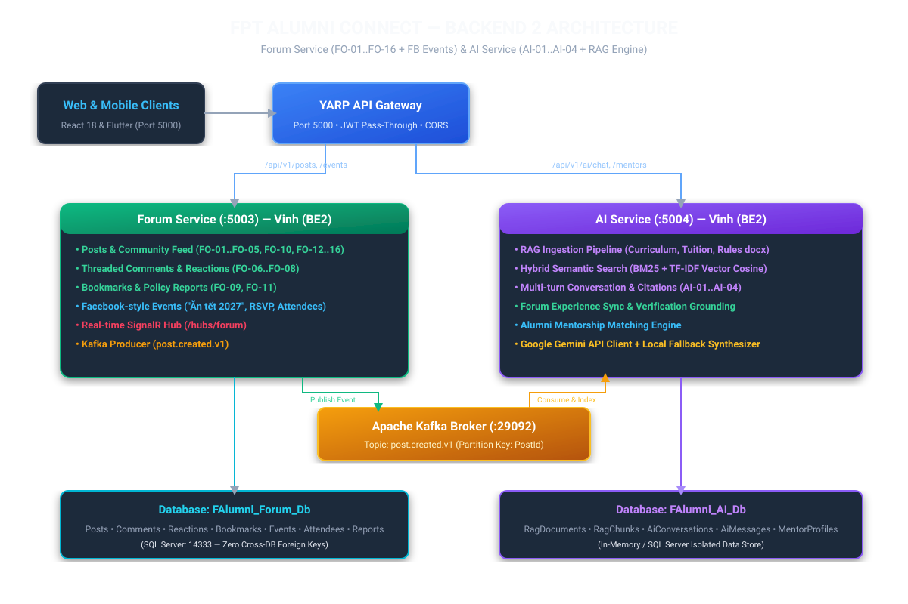
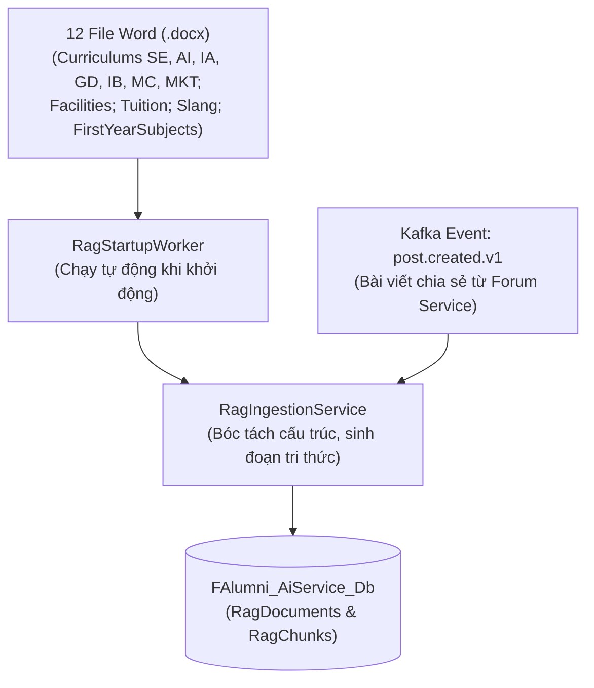
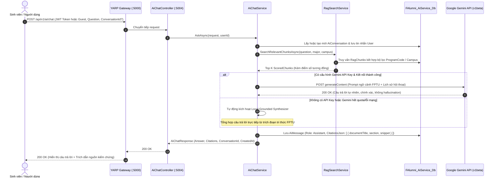

# 🏛️ Sơ Đồ Kiến Trúc Hệ Thống Chi Tiết — AI Service (`f-alumni-ai-service`)

> **Người thực hiện**: Vinh (`vinhmt` — Backend 2)  
> **Cổng dịch vụ**: `http://localhost:5004` (Cổng HTTPS: `https://localhost:7004`)  
> **Kiến trúc**: 3 tầng `.NET 10` (`Api -> Services -> Repositories`), Hybrid RAG Retrieval, Google Gemini API, Local Grounded Fallback Synthesizer, Mentor Recommendation, Event-driven Ingestion via Kafka.

---

## 1. Sơ Đồ Kiến Trúc RAG & Tổng Thể Hệ Thống



Hệ thống tuân thủ nghiêm ngặt nguyên tắc **Database-per-Service**: Toàn bộ dữ liệu tri thức RAG, phiên hội thoại, tin nhắn và hồ sơ cố vấn được lưu trữ cô lập trong `FAlumni_AiService_Db` (hoặc cấu hình fallback `FAlumni_AI_Db`), không tạo bất kỳ ràng buộc khóa ngoại trực tiếp nào sang các cơ sở dữ liệu của dịch vụ khác.

---

## 2. Đường Ống Nạp Dữ Liệu RAG (RAG Ingestion Pipeline)

Hệ thống hỗ trợ 2 cơ chế nạp tri thức đồng thời:
1. **Nạp tĩnh từ tài liệu Word (`.docx`)**: Tự động bóc tách 12 tệp Word đặc tả chương trình đào tạo FPTU (SE, AI, IA, GD, IB, MC, MKT, Học phí, Cơ sở vật chất, Môn năm nhất, Từ điển tiếng lóng Hola/Xavalo) khi khởi động hoặc qua endpoint `POST /api/v1/ai/rag/ingest`.
2. **Nạp động theo sự kiện Kafka (`post.created.v1`)**: Tự động tiếp nhận các bài viết chia sẻ kinh nghiệm cộng đồng từ Forum Service qua `IngestForumPostAsync`, gắn mã định danh `post_{postId}` và phân loại `ForumPost` vào kho tri thức RAG.



---

## 3. Luồng Hỏi Đáp AI Đa Lượt & Trích Dẫn Nguồn (Sequence Diagram)

Hỗ trợ xác thực kép: Tự động trích xuất `userId` từ JWT token hợp lệ, hoặc sử dụng định danh khách vãng lai mặc định (`11111111-1111-1111-1111-111111111111`) nếu người dùng chưa đăng nhập.



---

## 4. Thuật Toán Tìm Kiếm & Chấm Điểm Phân Đoạn RAG (Two-tier Retrieval Scoring)

Thuật toán trong `RagSearchService` kết hợp so khớp từ vựng (Lexical Matching) và tăng trọng số theo ý định người dùng (Intent Boosting):

1. **Khớp cụm từ chính xác (Exact Phrase Matching)**:
   - Cộng `+50.0` điểm nếu nội dung phân đoạn (`Content`) chứa toàn bộ câu hỏi chuẩn hóa.
2. **Tăng cường theo ý định (Intent Boosting)**:
   - Câu hỏi về học phí (`học phí`, `tiền`, `tuition`): `+40.0` điểm cho tài liệu thuộc loại `Tuition`.
   - Câu hỏi về năm nhất / rèn luyện (`vovinam`, `năm nhất`, `tiếng anh`): `+40.0` điểm cho loại `FirstYearSubjects` hoặc nội dung có chứa từ khóa Vovinam.
   - Câu hỏi về đời sống / khuôn viên (`hola`, `hòa lạc`, `xavalo`, `xe buýt`, `ký túc`): `+35.0` điểm cho loại `Slang`, `Facilities`.
   - Câu hỏi về bài viết / thảo luận (`kinh nghiệm`, `chia sẻ`, `forum`, `bài viết`): `+30.0` điểm cho loại `ForumPost`.
   - Khớp mã ngành (`ProgramCode`): `+30.0` điểm khi câu hỏi đề cập đến ngành đào tạo (vd: SE, AI, IA, Phần mềm, Trí tuệ nhân tạo, Bảo mật,...).
3. **So khớp từ khóa (Keyword / Term Matching)**:
   - Tiêu đề tài liệu (`docTitle`) chứa từ khóa: `+12.0` điểm.
   - Tên mục (`section`) chứa từ khóa: `+8.0` điểm.
   - Từ khóa (`keywords`) chứa từ khóa: `+6.0` điểm.
   - Tần suất xuất hiện trong nội dung (`content` term frequency): `+3.0` điểm mỗi lần xuất hiện (giới hạn tối đa 5 lần = `+15.0` điểm để tránh thiên lệch văn bản dài).
4. **Lọc ngưỡng chất lượng**:
   - Chỉ các phân đoạn có điểm số `Score > 5.0` mới được đưa vào danh sách ứng viên, sắp xếp giảm dần và lấy Top K (mặc định 4 phân đoạn phù hợp nhất).

---

## 5. Thuật Toán Gợi Ý Cố Vấn Cựu Sinh Viên (Mentor Recommendation Scoring)

Thực hiện trong `MentorRecommendationService` theo công thức tính điểm tương thích:

1. **Trùng khớp chuyên ngành (Major Match)**: `+50` điểm nếu `Mentor.Major` khớp với chuyên ngành sinh viên yêu cầu.
2. **Trùng khớp kỹ năng mục tiêu (Skill Match)**: Duyệt từng kỹ năng trong danh sách `TargetSkills`, cộng `+15` điểm cho mỗi kỹ năng xuất hiện trong hồ sơ cố vấn.
3. **Trùng khớp định hướng nghề nghiệp (Career Goal Match)**: Cộng `+20` điểm nếu `CareerGoal` xuất hiện trong `JobTitle` hoặc `Bio` của cố vấn.
4. **Giới hạn chuẩn hóa điểm số**:
   ```csharp
   MatchScore = Math.Min(100, Math.Max(score, 30));
   ```
   Điểm số được giới hạn trong thang điểm từ 30 đến 100%, giúp đảm bảo danh sách gợi ý luôn có độ tin cậy và thứ tự xếp hạng trực quan.

---

## 6. Danh Mục Endpoints Đầy Đủ

| Controller | Tuyến đường | Phương thức | Mô tả |
| :--- | :--- | :--- | :--- |
| `AiChatController` | `/api/v1/ai/chat` | `POST` | Hỏi đáp RAG thông minh, hội thoại đa lượt, trích dẫn nguồn. |
| `AiChatController` | `/api/v1/ai/conversations/{id}` | `GET` | Xem chi tiết lịch sử tin nhắn của phiên trò chuyện. |
| `AiChatController` | `/api/v1/ai/conversations` | `GET` | Danh sách các phiên trò chuyện của người dùng hiện tại. |
| `AiChatController` | `/api/v1/ai/rag/ingest` | `POST` | Kích hoạt nạp hoặc tái lập chỉ mục tài liệu tri thức RAG. |
| `MentorsController` | `/api/v1/ai/mentors/recommend` | `POST` | Gợi ý cựu sinh viên cố vấn theo ngành, kỹ năng và mục tiêu nghề nghiệp. |
| `SampleItemsController` | `/api/v1/sample-items` | `GET` | Danh sách tài nguyên mẫu (Public). |
| `SampleItemsController` | `/api/v1/sample-items/paged` | `GET` | Danh sách phân trang và tìm kiếm (Public). |
| `SampleItemsController` | `/api/v1/sample-items/{id}` | `GET` | Chi tiết tài nguyên mẫu (Public). |
| `SampleItemsController` | `/api/v1/sample-items` | `POST` | Tạo tài nguyên mẫu (`USER`, `ADMIN`). |
| `SampleItemsController` | `/api/v1/sample-items/{id}` | `PUT` | Cập nhật tài nguyên mẫu (`USER`, `ADMIN`). |
| `SampleItemsController` | `/api/v1/sample-items/{id}` | `DELETE` | Xóa tài nguyên mẫu (`ADMIN`). |
| `SampleItemsController` | `/api/v1/sample-items/admin-only`| `GET` | Thử nghiệm phân quyền quản trị viên (`ADMIN`). |
| `SampleItemsController` | `/api/v1/sample-items/me` | `GET` | Đọc thông tin claims định danh token hiện tại (`Authorize`). |
| `HealthChecks` | `/health` | `GET` | Kiểm tra tình trạng sống của AI Service. |
| `OpenApi` | `/openapi/v1.json` | `GET` | Cung cấp tài liệu OpenAPI JSON. |
