# 🗄️ Sơ Đồ ERD Cơ Sở Dữ Liệu — AI Service (`FAlumni_AiService_Db` / `FAlumni_AI_Db`)

> **Service**: `f-alumni-ai-service`  
> **Người phụ trách**: Vinh (`vinhmt` — Backend 2)  
> **Cơ sở dữ liệu**: `FAlumni_AiService_Db` (SQL Server + EF Core 10)  
> **Nguyên tắc kiến trúc**: Database-per-Service — Tuyệt đối không foreign key sang cơ sở dữ liệu khác (Zero Cross-Database Foreign Keys). Lưu trữ kho tri thức RAG (tài liệu, phân mảnh tri thức, từ khóa), phiên hội thoại AI đa lượt (`AiConversations`), lịch sử tin nhắn (`AiMessages`), danh bạ cố vấn (`MentorProfiles`), và tài nguyên mẫu hệ thống (`SampleItems`).

---

## 1. Sơ Đồ ERD Chuẩn Mermaid

```mermaid
erDiagram
    RagDocuments ||--o{ RagChunks : "1:N (DocumentId, Cascade)"
    AiConversations ||--o{ AiMessages : "1:N (ConversationId, Cascade)"

    RagDocuments {
        uniqueidentifier Id PK "Guid.NewGuid()"
        nvarchar_300 Title "NOT NULL"
        nvarchar_500 SourcePath "NOT NULL (Đường dẫn tệp .docx hoặc định danh bài viết forum)"
        nvarchar_50 DocumentType "NOT NULL (Curriculum | Facilities | Tuition | Slang | FirstYearSubjects | ForumPost | Regulations)"
        nvarchar_50 ProgramCode "NULL (BIT_SE | BIT_AI | BIT_IA | BIT_GD | BBA_IB | BBA_MC | BBA_MKT)"
        nvarchar_50 Campus "NOT NULL, Default 'All' (FU-HL | FU-HCM | FU-DN | FU-CT | FU-QN | All)"
        datetime2 CreatedAt "NOT NULL (Thời gian nạp tài liệu)"
    }

    RagChunks {
        uniqueidentifier Id PK "Guid.NewGuid()"
        uniqueidentifier DocumentId FK "NOT NULL -> RagDocuments.Id"
        nvarchar_150 ChunkIdentifier "NOT NULL (vd: chunk_1, post_{postId})"
        nvarchar_300 Section "NOT NULL (Tên môn, tiêu đề mục, đề mục tri thức)"
        nvarchar_max Content "NOT NULL (Nội dung chi tiết của đoạn tri thức)"
        nvarchar_max Keywords "NOT NULL (Từ khóa tìm kiếm phục vụ chấm điểm truy xuất)"
    }

    AiConversations {
        uniqueidentifier Id PK "Guid.NewGuid()"
        uniqueidentifier UserId "NOT NULL (Pure Guid - User ID từ JWT hoặc Guest GUID)"
        nvarchar_250 Title "NOT NULL, Default 'Cuộc trò chuyện mới'"
        datetime2 CreatedAt "NOT NULL (Thời gian khởi tạo phiên)"
        datetime2 LastMessageAt "NOT NULL (Thời điểm có tin nhắn mới nhất)"
    }

    AiMessages {
        uniqueidentifier Id PK "Guid.NewGuid()"
        uniqueidentifier ConversationId FK "NOT NULL -> AiConversations.Id"
        nvarchar_20 Role "NOT NULL ('user' | 'assistant')"
        nvarchar_max Content "NOT NULL (Nội dung câu hỏi hoặc phản hồi)"
        nvarchar_max CitationsJson "NOT NULL, Default '[]' (Mảng JSON trích dẫn nguồn thực tế)"
        datetime2 CreatedAt "NOT NULL (Thời gian tạo tin nhắn)"
    }

    MentorProfiles {
        uniqueidentifier Id PK "Guid.NewGuid()"
        uniqueidentifier UserId "NOT NULL (Guid đại diện cho cựu sinh viên cố vấn)"
        nvarchar_200 FullName "NOT NULL (Họ và tên cựu sinh viên)"
        nvarchar_200 Email "NOT NULL (Địa chỉ email liên hệ)"
        nvarchar_50 Major "NOT NULL (SE | AI | IA | GD | IB | MC | MKT)"
        nvarchar_max CurrentCompany "NOT NULL (Công ty hiện đang công tác)"
        nvarchar_max JobTitle "NOT NULL (Chức danh / Vị trí công việc)"
        nvarchar_max Skills "NOT NULL (Kỹ năng chuyên môn, công nghệ thế mạnh)"
        nvarchar_max Bio "NOT NULL (Tiểu sử giới thiệu ngắn gọn)"
        nvarchar_max AvatarUrl "NOT NULL (Đường dẫn ảnh đại diện)"
    }

    SampleItems {
        uniqueidentifier Id PK "Guid.NewGuid()"
        nvarchar_100 Name "NOT NULL (Tên tài nguyên mẫu)"
        nvarchar_500 Description "NOT NULL, Default '' (Mô tả chi tiết)"
        bit IsActive "NOT NULL, Default 1 (Trạng thái hoạt động)"
        datetime2 CreatedAtUtc "NOT NULL (Thời điểm tạo UTC)"
    }
```

---

## 2. Chi Tiết Thực Thể & Ràng Buộc Khóa Trong Mã Nguồn

| Tên Bảng (DbSet) | Khóa Chính (PK) | Khóa Ngoại (FK) | Ràng Buộc Toàn Vẹn & Kích Thước |
| :--- | :--- | :--- | :--- |
| **`RagDocuments`** | `Id` (GUID) | Không | `Title` (300), `SourcePath` (500), `DocumentType` (50), `ProgramCode` (50, NULL), `Campus` (50). |
| **`RagChunks`** | `Id` (GUID) | `DocumentId` -> `RagDocuments(Id)` | `ChunkIdentifier` (150), `Section` (300), `Content` (MAX), `Keywords` (MAX). Xóa tài liệu sẽ Cascade xóa chunks. |
| **`AiConversations`** | `Id` (GUID) | Không (UserId độc lập) | `Title` (250). Hỗ trợ cả người dùng đăng nhập và khách vãng lai (Guest fallback). |
| **`AiMessages`** | `Id` (GUID) | `ConversationId` -> `AiConversations(Id)` | `Role` (20), `Content` (MAX), `CitationsJson` (MAX). Cascade xóa theo phiên hội thoại. |
| **`MentorProfiles`** | `Id` (GUID) | Không (UserId độc lập) | `FullName` (200), `Email` (200), `Major` (50), `CurrentCompany` (MAX), `JobTitle` (MAX), `Skills` (MAX), `Bio` (MAX), `AvatarUrl` (MAX). |
| **`SampleItems`** | `Id` (GUID) | Không | `Name` (100), `Description` (500), `IsActive` (bit, default 1), `CreatedAtUtc` (datetime2). |

---

## 3. Các Chỉ Mục Tối Ưu Hóa (Indexes Khớp 100% `AiConfiguration.cs`)

1. **`RagDocuments(DocumentType)`**: Tăng tốc lọc kho tài liệu theo loại chuyên biệt (`Curriculum`, `Tuition`, `Facilities`, `Slang`, `FirstYearSubjects`, `ForumPost`).
2. **`RagDocuments(ProgramCode)`**: Tăng tốc truy vấn các tài liệu thuộc chuyên ngành sinh viên yêu cầu (`BIT_SE`, `BIT_AI`, `BIT_IA`, `BBA_IB`,...).
3. **`RagDocuments(Campus)`**: Tối ưu lọc phạm vi cơ sở FPTU (`FU-HL`, `FU-HCM`, `FU-DN`, `All`).
4. **`RagChunks(DocumentId)`**: Tối ưu truy xuất danh sách phân mảnh thuộc một tài liệu và hỗ trợ cơ chế xóa phân tầng (Cascade Delete).
5. **`RagChunks(ChunkIdentifier)`**: Tăng tốc tra cứu phân mảnh tri thức theo mã định danh (vd: `chunk_1`, `post_{postId}`).
6. **`AiConversations(UserId)`**: Lấy danh sách các phiên trò chuyện của một người dùng cụ thể với thời gian phản hồi tức thì.
7. **`AiConversations(LastMessageAt)`**: Sắp xếp danh sách phiên hội thoại theo thứ tự hoạt động mới nhất.
8. **`AiMessages(ConversationId)`**: Tải toàn bộ chuỗi ngữ cảnh hội thoại đa lượt (Multi-turn Context) phục vụ gửi sang mô hình LLM.
9. **`MentorProfiles(Major)`**: Tăng tốc lọc danh bạ cố vấn cựu sinh viên theo chuyên ngành đào tạo khi tính toán điểm tương thích (MatchScore).
