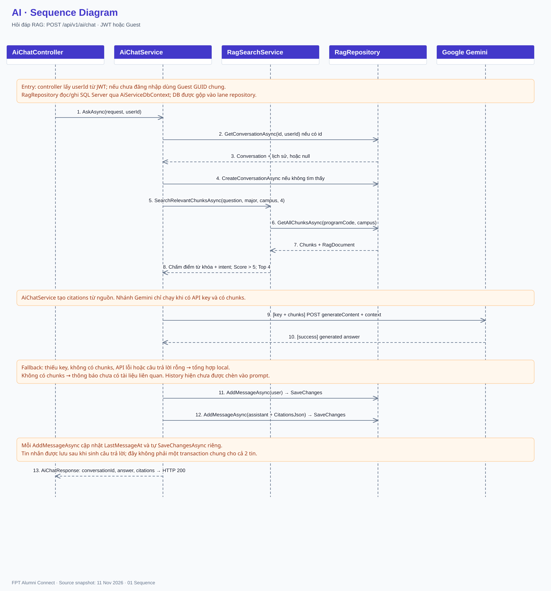
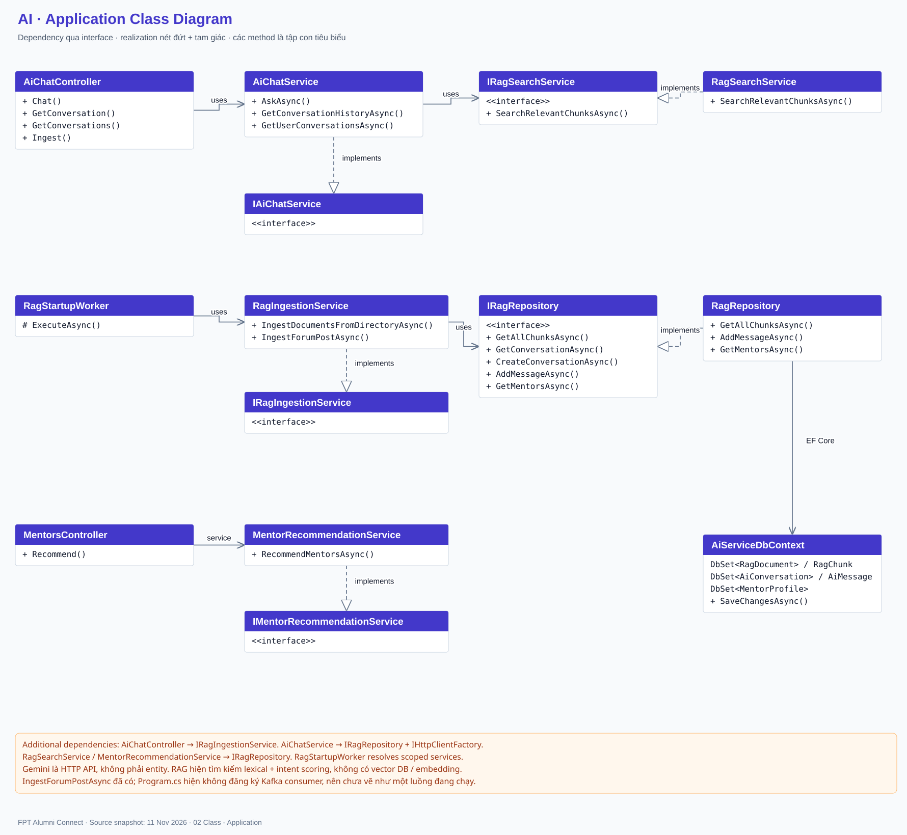
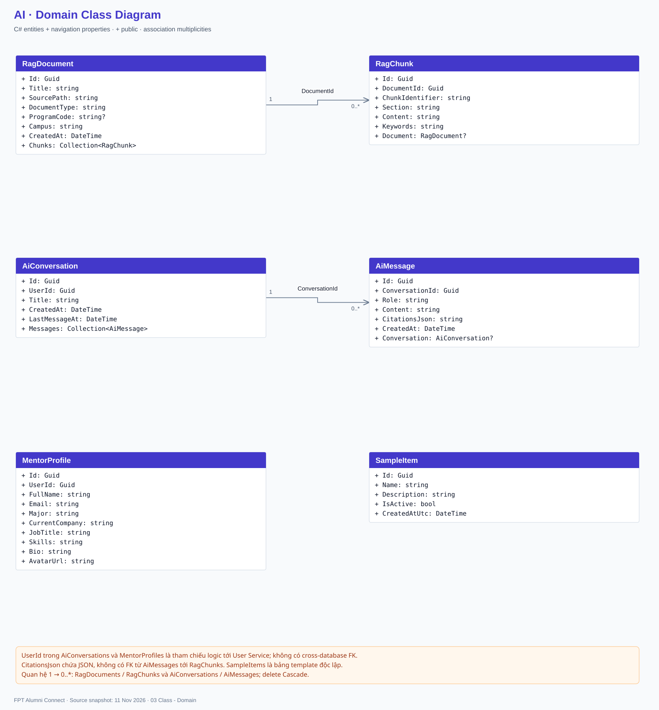
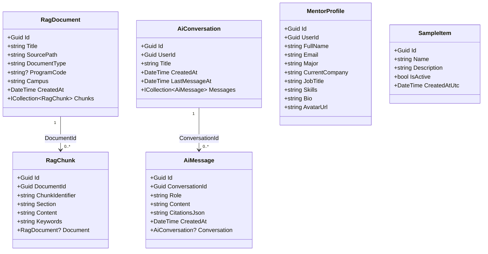
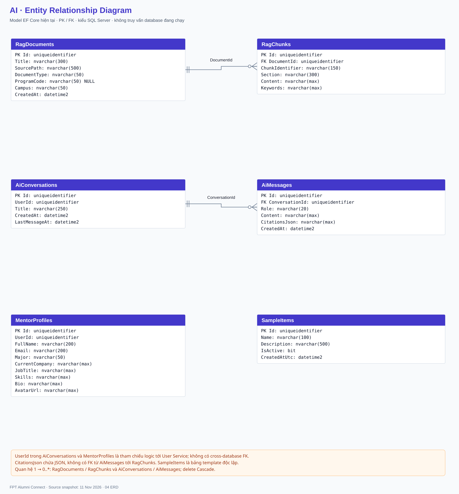
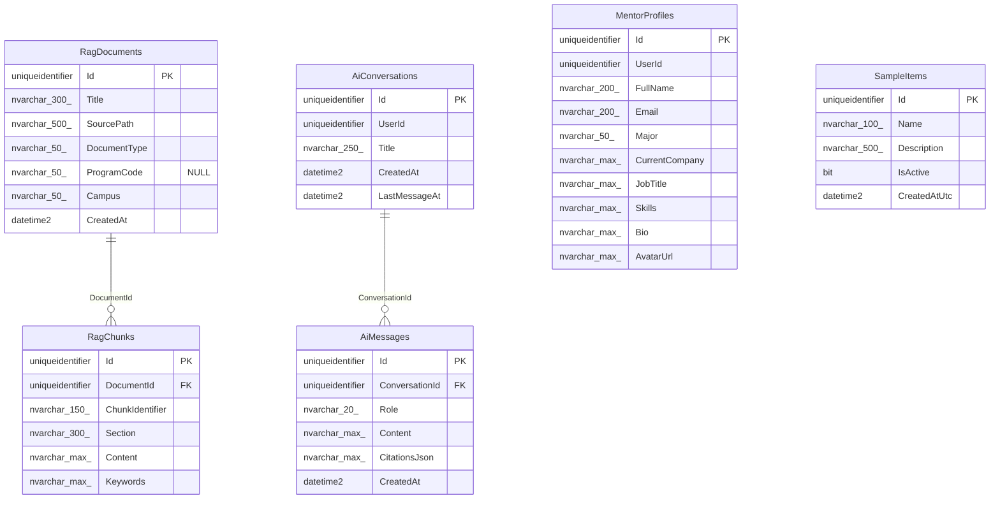

# AI — Diagrams

Source snapshot: 2026-11-11.

[Offline viewer](AI-Diagrams.html) · [Editable diagrams.net](AI-Diagrams.drawio)

- AI DB theo appsettings: FAlumni_AiService_Db; repository fallback dùng FAlumni_AI_Db. ERD gồm 6 bảng.
- RAG dùng keyword/intent scoring, lọc Score > 5 rồi lấy Top 4. Chưa có vector database hoặc embedding.
- Lịch sử hội thoại được lưu/đọc nhưng GenerateWithGeminiAsync hiện chưa chèn history vào prompt.
- IngestForumPostAsync đã có; chưa có Kafka consumer đăng ký trong Program.cs. Đây là điểm tích hợp cần hoàn thiện.
- CitationsJson là JSON, không có FK tới RagChunks. Guest đang dùng chung một GUID theo controller.

ERD reflects current EF Core entities and Fluent API; the live SQL Server schema has not been inspected.

## 01 Sequence

## 02 Class - Application

## 03 Class - Domain

## 04 ERD

## Source references

- `AiService.Api/Controllers/AiChatController.cs`
- `AiService.Api/Program.cs`
- `AiService.Api/Workers/RagStartupWorker.cs`
- `AiService.Services/Implementations/AiChatService.cs`
- `AiService.Services/Implementations/RagSearchService.cs`
- `AiService.Services/Implementations/RagIngestionService.cs`
- `AiService.Repositories/Implementations/RagRepository.cs`
- `AiService.Repositories/Entities/AiEntities.cs`
- `AiService.Repositories/Configurations/AiConfiguration.cs`
