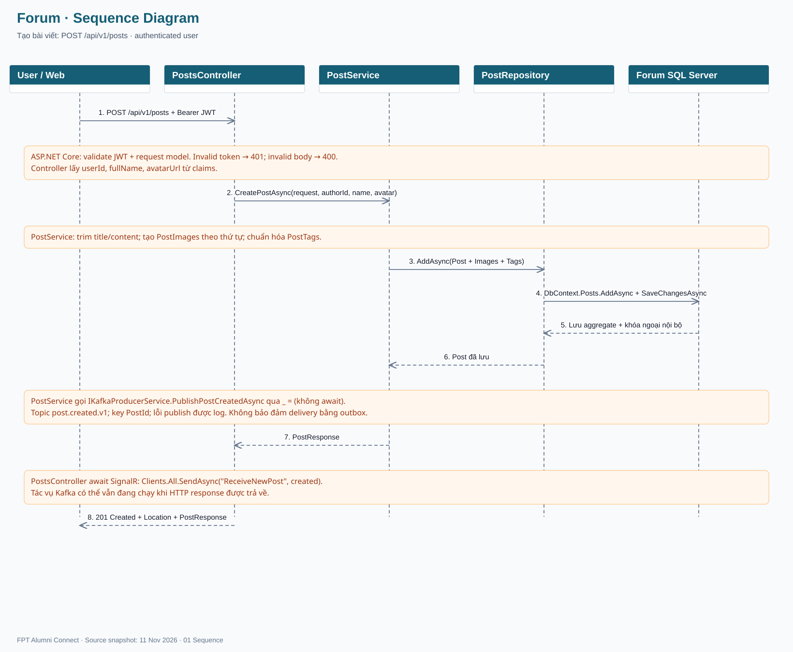
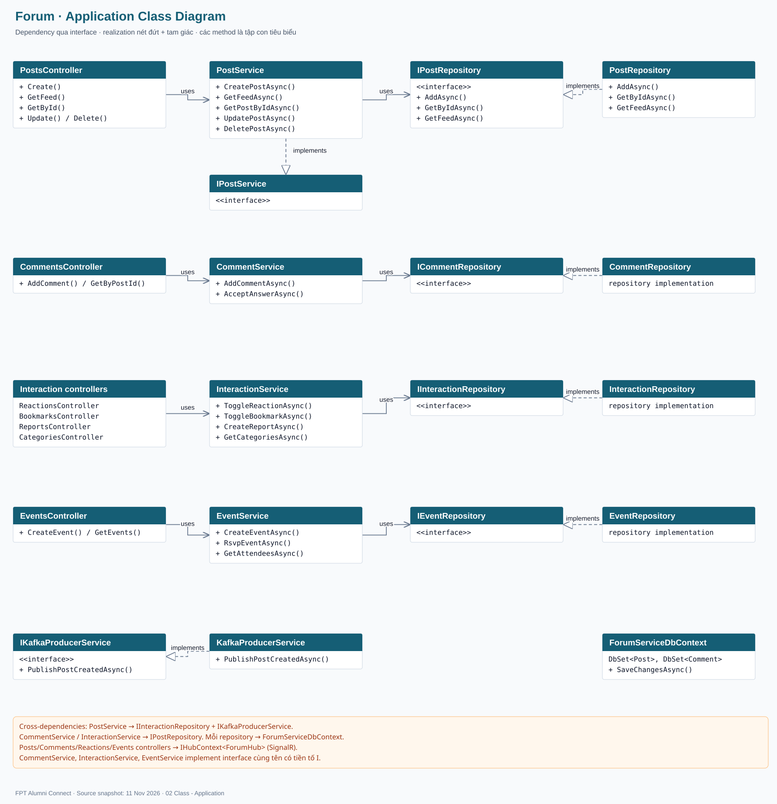
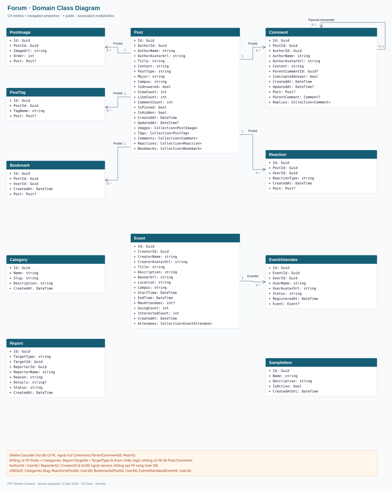
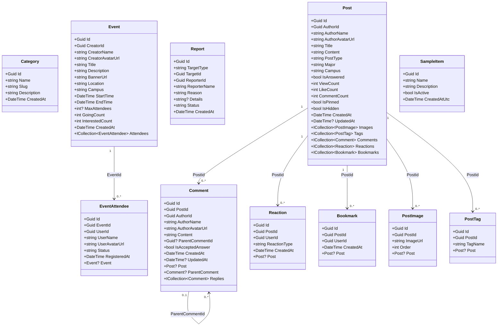
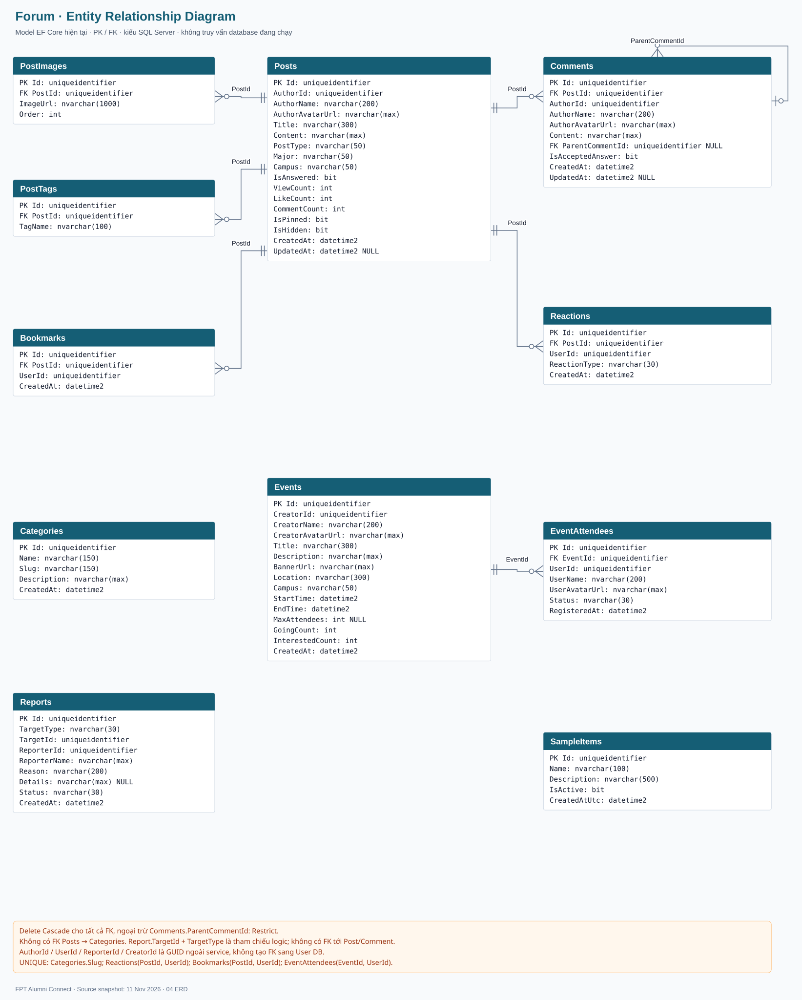
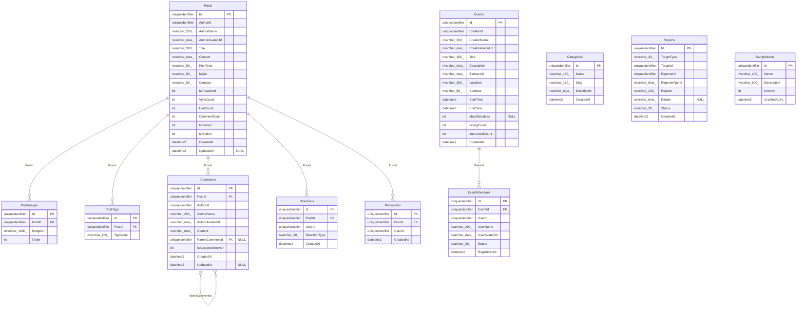

# Forum — Diagrams

Source snapshot: 2026-11-11.

[Offline viewer](Forum-Diagrams.html) · [Editable diagrams.net](Forum-Diagrams.drawio)

- Forum DB theo appsettings: FAlumni_Forum_Db. ERD gồm đủ 11 bảng trong DbContext, bao gồm SampleItems.
- Kafka publish dùng fire-and-forget; lỗi được log. SignalR broadcast được await trước HTTP 201.
- Categories chưa liên kết FK tới Posts. Reports dùng TargetType + TargetId, không phải FK vật lý.
- Comment.ParentCommentId nullable, delete Restrict; các FK còn lại delete Cascade.

ERD reflects current EF Core entities and Fluent API; the live SQL Server schema has not been inspected.

## 01 Sequence

## 02 Class - Application

## 03 Class - Domain

## 04 ERD

## Source references

- `ForumService.Api/Controllers/PostsController.cs`
- `ForumService.Services/Implementations/PostService.cs`
- `ForumService.Services/Implementations/KafkaProducerService.cs`
- `ForumService.Repositories/Implementations/PostRepository.cs`
- `ForumService.Repositories/Entities/*.cs`
- `ForumService.Repositories/Configurations/ForumConfiguration.cs`
- `ForumService.Repositories/Context/ForumServiceDbContext.cs`
