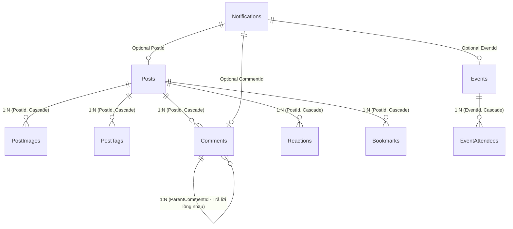

# FPT Alumni Connect — Forum Service (`f-alumni-forum-service`)

Dịch vụ Quản lý Diễn đàn Thảo luận, Bảng tin Cộng đồng FPTU, Hỏi đáp Chuyên ngành, Sự kiện Mạng xã hội (Facebook-style Events), Bình luận Đa cấp, Tương tác Tim/Bookmark và **Hệ thống Thông báo Thời gian thực (Notifications)** thuộc hệ thống **FPT Alumni Connect** (PRN232 Final Assignment). Được xây dựng theo chuẩn kiến trúc 3 tầng `.NET 10` (`Api -> Services -> Repositories`), SignalR WebSockets (`ForumHub`), và Kafka Producer (`post.created.v1`).

- **Owner**: Vinh (`vinhmt` — Backend 2)
- **Cổng dịch vụ (Service Port)**: `http://localhost:5003` (Cổng HTTPS: `https://localhost:7003`)
- **Database**: `FAlumni_Forum_Db` (Độc lập 100% — Zero Cross-Database Foreign Keys, lưu `UserId` dạng `Guid` độc lập)
- **Tài liệu ERD Database**: [`docs/ERD.md`](docs/ERD.md)
- **Tài liệu Kiến trúc Hệ thống**: [`docs/ARCHITECTURE.md`](docs/ARCHITECTURE.md) | [`docs/architecture/f-alumni-be2-architecture.svg`](docs/architecture/f-alumni-be2-architecture.svg)

---

## 🗄️ Sơ Đồ ERD Cơ Sở Dữ Liệu (`FAlumni_Forum_Db`)



> Xem đặc tả chi tiết từng bảng (`Categories`, `Posts`, `PostImages`, `PostTags`, `Comments`, `Reactions`, `Bookmarks`, `Reports`, `Events`, `EventAttendees`, `Notifications`, `SampleItems`), kiểu dữ liệu, ràng buộc và chỉ mục tại [`docs/ERD.md`](docs/ERD.md).

---

## 🚀 Toàn Bộ Tính Năng & API Endpoints (FO-01 đến FO-16 + Events + Notifications)

### 1. Diễn đàn, Bình luận, Tim & Bookmark
| Mã US | Tên tính năng & Nghiệp vụ chi tiết | Phương thức HTTP | Đường dẫn Endpoint | Xác thực (Auth) |
| :--- | :--- | :--- | :--- | :--- |
| **FO-01..03** | Tạo/Cập nhật bài viết kèm phân loại (`Question`, `Sharing`, `Recruitment`), chuyên ngành, cơ sở, ảnh (`imageUrls`), thẻ (`tags`) | `POST`<br>`PUT` | `/api/v1/posts`<br>`/api/v1/posts/{id}` | Bearer JWT |
| **FO-04** | Xem chi tiết hoặc xóa bài viết (Kiểm tra quyền chính chủ tác giả hoặc Admin) | `GET`<br>`DELETE` | `/api/v1/posts/{id}` | Public (GET)<br>Bearer JWT (DELETE) |
| **FO-05, 12..16** | Newsfeed có phân trang & lọc theo `campus`, `major`, `postType`, `search`, `sort=popular\|latest`, `isAnswered=true\|false` | `GET` | `/api/v1/posts` | Public (Token tùy chọn để trả về `hasLiked`, `isBookmarked`) |
| **FO-10** | Xem danh sách bài viết của chính mình | `GET` | `/api/v1/posts/me` | Bearer JWT |
| **FO-06..07** | Xem cây bình luận đa cấp, gửi bình luận/trả lời lồng nhau (`parentCommentId`), sửa, xóa đệ quy (tự đồng bộ `CommentCount` và `IsAnswered`) | `GET` / `POST`<br>`PUT` / `DELETE` | `/api/v1/posts/{id}/comments`<br>`/api/v1/comments/{id}` | Public (GET)<br>Bearer JWT (POST/PUT/DELETE) |
| **FO-16** | Tác giả chấp nhận câu trả lời đúng nhất / đánh dấu đã giải đáp | `POST`<br>`PATCH` | `/api/v1/comments/{id}/accept`<br>`/api/v1/posts/{id}/answered` | Bearer JWT (Tác giả bài viết) |
| **FO-08** | Thả tim / Bỏ tim bài viết (Toggle, phát SignalR `ReceiveReaction` & tạo thông báo) | `POST` | `/api/v1/posts/{id}/react` | Bearer JWT |
| **FO-09** | Lưu bài viết (Bookmark toggle) và xem danh sách bài viết đã lưu | `POST`<br>`GET` | `/api/v1/posts/{id}/bookmark`<br>`/api/v1/bookmarks/me` | Bearer JWT |
| **FO-11** | Báo cáo bài viết hoặc bình luận vi phạm quy chuẩn | `POST` | `/api/v1/reports` | Bearer JWT |
| **Danh mục** | Lấy danh sách danh mục diễn đàn | `GET` | `/api/v1/categories` | Public |

### 2. Sự kiện Cộng đồng (Events)
| Chức năng | Phương thức HTTP | Đường dẫn Endpoint | Xác thực (Auth) |
| :--- | :--- | :--- | :--- |
| Danh sách & Chi tiết sự kiện | `GET` | `/api/v1/events`<br>`/api/v1/events/{id}` | Public (Token tùy chọn lấy trạng thái RSVP) |
| Tạo & Xóa sự kiện | `POST`<br>`DELETE` | `/api/v1/events`<br>`/api/v1/events/{id}` | Bearer JWT |
| Đăng ký tham gia (`Going`, `Interested`, `NotGoing`) | `POST` | `/api/v1/events/{id}/rsvp` | Bearer JWT |
| Danh sách người tham gia sự kiện | `GET` | `/api/v1/events/{id}/attendees` | Public |

### 3. Hệ thống Thông báo Thời gian thực (Notifications — Mới)
| Chức năng | Phương thức HTTP | Đường dẫn Endpoint | Xác thực (Auth) |
| :--- | :--- | :--- | :--- |
| Lấy danh sách thông báo phân trang (hỗ trợ `?unreadOnly=true`) | `GET` | `/api/v1/notifications` | Bearer JWT |
| Đếm số lượng thông báo chưa đọc (Badge chuông) | `GET` | `/api/v1/notifications/unread-count` | Bearer JWT |
| Đánh dấu 1 thông báo là đã đọc | `PATCH` | `/api/v1/notifications/{id}/read` | Bearer JWT |
| Đánh dấu toàn bộ thông báo là đã đọc | `PATCH` | `/api/v1/notifications/read-all` | Bearer JWT |
| Xóa một thông báo | `DELETE` | `/api/v1/notifications/{id}` | Bearer JWT |

**Các sự kiện tự động sinh thông báo & đẩy Real-time qua SignalR:**
- `POST_REACTION`: Khi có người thả tim bài viết của bạn.
- `POST_COMMENT`: Khi có người bình luận vào bài viết của bạn.
- `COMMENT_REPLY`: Khi có người trả lời bình luận của bạn.
- `COMMENT_ACCEPTED`: Khi chủ bài viết chấp nhận câu trả lời của bạn.
- `EVENT_RSVP`: Khi có người đăng ký tham gia sự kiện do bạn tạo.

### 4. Real-time SignalR & Kafka
| Kênh / Giao thức | Đường dẫn / Topic | Sự kiện hỗ trợ |
| :--- | :--- | :--- |
| **SignalR Hub (`WSS`)** | `/hubs/forum` (Bearer Header hoặc `?access_token=`) | `ReceiveNotification`, `ReceiveUnreadCount`, `ReceiveReaction`, `ReceiveNewEvent`, `ReceiveEventRsvp`, `ReceiveNewPost`, `ReceiveNewComment` |
| **Kafka Producer** | Topic `post.created.v1` | Tự động phát sự kiện `EventEnvelope<PostCreatedEventV1>` khi tạo bài viết mới |
| **Health & OpenAPI** | `GET /health`<br>`GET /openapi/v1.json` | Kiểm tra sức khỏe dịch vụ & OpenAPI Docs (Development) |

---

## ⚙️ Cấu Hình Môi Trường & Bảo Mật (Không Hardcode)

```json
// src/ForumService.Api/appsettings.json
{
  "ConnectionStrings": {
    "DefaultConnection": "Server=localhost\\SQLEXPRESS;Database=FAlumni_Forum_Db;Trusted_Connection=True;TrustServerCertificate=True;"
  },
  "Jwt": {
    "Issuer": "https://identity.falumni.local",
    "Audience": "falumni-services",
    "Key": "",
    "ClockSkewMinutes": 1
  },
  "Kafka": {
    "BootstrapServers": "localhost:29092"
  }
}
```

### Biến môi trường ghi đè:
- `ConnectionStrings__DefaultConnection`: Chuỗi kết nối SQL Server.
- `Jwt__Key` hoặc `JWT_SECRET_KEY`: Khóa bí mật JWT (tối thiểu 32 ký tự).
- `Kafka__BootstrapServers` hoặc `KAFKA_BOOTSTRAP_SERVERS`: Địa chỉ Kafka Broker.

---

## 🛠️ Hướng Dẫn Migration, Chạy & Kiểm Thử Tự Động

```powershell
# 1. Xác minh tính toàn vẹn hợp đồng SHA-256
pwsh -ExecutionPolicy Bypass -File .\scripts\verify-contracts.ps1

# 2. Áp dụng EF Core Migration lên SQL Server (tạo bảng Posts, Comments, Reactions, Bookmarks, Events, Notifications...)
dotnet ef database update --project src/ForumService.Repositories/ForumService.Repositories.csproj

# 3. Chạy toàn bộ Unit Test & API Integration Test (47 passed)
dotnet test ForumService.sln --configuration Release

# 4. Khởi chạy dịch vụ cục bộ trên cổng 5003
$env:Jwt__Key = "YourSuperSecretSigningKeyAtLeast32BytesLong!"
dotnet run --project src/ForumService.Api/ForumService.Api.csproj
```
