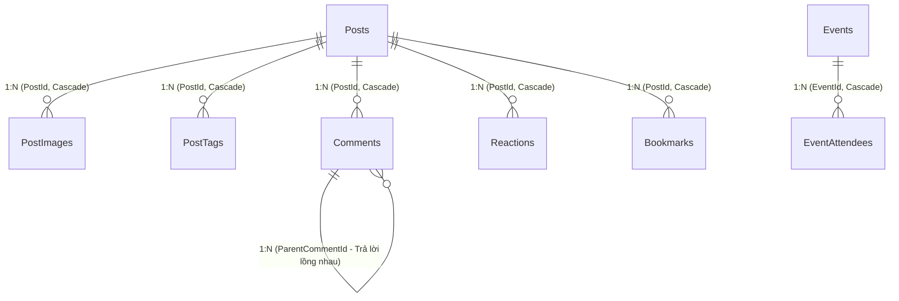

# FPT Alumni Connect — Forum Service (`f-alumni-forum-service`)

Dịch vụ Quản lý Diễn đàn Thảo luận, Bảng tin Cộng đồng FPTU, Hỏi đáp Chuyên ngành, Sự kiện Mạng xã hội (Facebook-style Events), Bình luận Đa cấp, Tương tác Like/Bookmark và Thông báo Thời gian thực thuộc hệ thống **FPT Alumni Connect** (PRN232 Final Assignment). Được xây dựng theo chuẩn kiến trúc 3 tầng `.NET 10` (`Api -> Services -> Repositories`), SignalR WebSockets (`ForumHub`), và Kafka Producer (`post.created.v1`).

- **Owner**: Vinh (`vinhmt` — Backend 2)
- **Cổng dịch vụ (Service Port)**: `http://localhost:5003` (Cổng HTTPS: `https://localhost:7003`)
- **Database**: `FAlumni_Forum_Db` (Độc lập 100% — Zero Cross-Database Foreign Keys, lưu `UserId` dạng `Guid` độc lập)
- **Tài liệu ERD Database**: [`docs/ERD.md`](docs/ERD.md)
- **Tài liệu Kiến trúc Hệ thống**: [`docs/ARCHITECTURE.md`](docs/ARCHITECTURE.md) | [`docs/architecture/f-alumni-be2-architecture.svg`](docs/architecture/f-alumni-be2-architecture.svg)

---

## 🗄️ Sơ Đồ ERD Cơ Sở Dữ Liệu (`FAlumni_Forum_Db`)



> Xem đặc tả chi tiết từng bảng, kiểu dữ liệu, ràng buộc và chỉ mục tại [`docs/ERD.md`](docs/ERD.md).

---

## 🚀 Toàn Bộ Tính Năng & User Stories Đã Hoàn Thành (FO-01 đến FO-16 + Events)

| Mã US | Tên tính năng & Nghiệp vụ chi tiết | Phương thức HTTP / Giao thức | Đường dẫn Endpoint / Hub | Xác thực (Auth) |
| :--- | :--- | :--- | :--- | :--- |
| **FO-01** | Tạo bài viết hỏi đáp hoặc chia sẻ kinh nghiệm học tập FPTU | `POST` | `/api/v1/posts` | Bearer JWT (Bắt buộc) |
| **FO-02** | Đánh dấu phân loại bài đăng (`Question`, `Sharing`, `Recruitment`), chuyên ngành (`SE`, `AI`, `IA`, `GD`, `IB`, `MC`, `MKT`, `All`) và cơ sở (`FU-HCM`, `FU-HL`, `FU-DN`, `FU-CT`, `FU-QN`, `All`) | `POST` / `PUT` | `/api/v1/posts`<br>`/api/v1/posts/{id}` | Bearer JWT |
| **FO-03** | Đính kèm danh sách hình ảnh minh họa bài viết (`imageUrls: string[]`) | `POST` / `PUT` | Trong payload bài viết | Bearer JWT |
| **FO-04** | Xem chi tiết, chỉnh sửa hoặc xóa bài viết (Kiểm tra quyền chính chủ tác giả hoặc Admin) | `GET`<br>`PUT`<br>`DELETE` | `/api/v1/posts/{id}` | Public (GET)<br>Bearer JWT (PUT/DELETE) |
| **FO-05** | Xem bảng tin cộng đồng FPTU (Newsfeed) có phân trang | `GET` | `/api/v1/posts` | Public (Token tùy chọn để lấy cờ `hasLiked`) |
| **FO-06** | Xem và gửi bình luận dưới bài viết | `GET`<br>`POST` | `/api/v1/posts/{id}/comments` | Public (GET)<br>Bearer JWT (POST) |
| **FO-07** | Trả lời bình luận đa cấp (`parentCommentId`), chỉnh sửa và xóa bình luận | `POST`<br>`PUT`<br>`DELETE` | `/api/v1/posts/{id}/comments`<br>`/api/v1/comments/{id}` | Bearer JWT (Chính chủ/Admin) |
| **FO-08** | Like hoặc Unlike bài viết (Toggle, phát cập nhật thời gian thực qua SignalR) | `POST` | `/api/v1/posts/{id}/react` | Bearer JWT |
| **FO-09** | Lưu bài viết (Bookmark toggle) và xem danh sách bài viết đã lưu của mình | `POST`<br>`GET` | `/api/v1/posts/{id}/bookmark`<br>`/api/v1/bookmarks/me` | Bearer JWT |
| **FO-10** | Quản lý và xem danh sách bài viết do chính mình đã đăng | `GET` | `/api/v1/posts/me` | Bearer JWT |
| **FO-11** | Báo cáo bài viết hoặc bình luận vi phạm quy chuẩn FPTU | `POST` | `/api/v1/reports` | Bearer JWT |
| **FO-12** | Lọc bài viết theo Cơ sở Campus (`FU-HCM`, `FU-HL`, `FU-DN`, `FU-CT`, `FU-QN`, `All`) | `GET` | `/api/v1/posts?campus=FU-HCM` | Public / Optional |
| **FO-13** | Tìm kiếm bài viết theo từ khóa tiêu đề, nội dung hoặc thẻ hashtag | `GET` | `/api/v1/posts?search=react` | Public / Optional |
| **FO-14** | Sắp xếp bài viết theo phổ biến nhất hoặc mới nhất (`sort=popular` / `sort=latest`) | `GET` | `/api/v1/posts?sort=popular` | Public / Optional |
| **FO-15** | Lọc các câu hỏi chưa có câu trả lời để hỗ trợ sinh viên khác (`isAnswered=false`) | `GET` | `/api/v1/posts?isAnswered=false` | Public / Optional |
| **FO-16** | Lọc câu hỏi đã giải đáp & Tác giả chấp thuận câu trả lời đúng | `GET`<br>`POST`<br>`PATCH` | `/api/v1/posts?isAnswered=true`<br>`/api/v1/comments/{id}/accept`<br>`/api/v1/posts/{id}/answered` | Public (GET)<br>Bearer JWT (POST/PATCH) |
| **Sự kiện FB** | Tạo, xem chi tiết và hủy sự kiện kiểu Facebook (Offline/Online meetup) | `POST`<br>`GET`<br>`DELETE` | `/api/v1/events`<br>`/api/v1/events/{id}` | Bearer JWT (POST/DELETE)<br>Public (GET) |
| **RSVP Event** | Đăng ký hoặc đổi trạng thái tham gia sự kiện (`Going`, `Interested`, `NotGoing`) | `POST` | `/api/v1/events/{id}/rsvp` | Bearer JWT |
| **DS Event** | Xem danh sách sự kiện sắp tới và danh sách người tham gia từng sự kiện | `GET` | `/api/v1/events`<br>`/api/v1/events/{id}/attendees` | Public / Optional |
| **SignalR** | Hub thời gian thực cập nhật bài viết mới, bình luận, like, sự kiện, RSVP | `WSS` | `/hubs/forum` | Bearer Header / `?access_token=` |
| **Kafka** | Phát sự kiện domain `post.created.v1` mỗi khi tạo bài viết thành công | Kafka Broker | Topic `post.created.v1` | Bất đồng bộ nền |
| **Danh mục** | Lấy danh mục diễn đàn tham khảo (`Categories`) | `GET` | `/api/v1/categories` | Public |
| **Health** | Kiểm tra trạng thái hoạt động của dịch vụ (Health Check) | `GET` | `/health` | Public |

---

## ⚙️ Cấu Hình Môi Trường & Bảo Mật (Không Hardcode)

Hệ thống tuân thủ nghiêm ngặt nguyên tắc **zero hardcoded secrets**. Mọi tham số cấu hình đều được đọc tự động từ file cấu hình hoặc biến môi trường:

```json
// src/ForumService.Api/appsettings.json
{
  "ConnectionStrings": {
    "DefaultConnection": "Server=localhost\\SQLEXPRESS;Database=FAlumni_Forum_Db;Trusted_Connection=True;TrustServerCertificate=True;"
  },
  "Jwt": {
    "Issuer": "https://identity.falumni.local",
    "Audience": "falumni-services",
    "Key": "",
    "ClockSkewMinutes": 1
  },
  "Kafka": {
    "BootstrapServers": "localhost:29092"
  }
}
```

### Các biến môi trường hỗ trợ ghi đè khi chạy Production / Docker:
- `ConnectionStrings__DefaultConnection`: Chuỗi kết nối SQL Server.
- `Jwt__Key` hoặc `JWT_SECRET_KEY`: Khóa bí mật JWT (tối thiểu 32 ký tự).
- `Kafka__BootstrapServers` hoặc `KAFKA_BOOTSTRAP_SERVERS`: Địa chỉ cụm Kafka Broker.

---

## 🛠️ Hướng Dẫn Chạy & Kiểm Thử Tự Động

```powershell
# 1. Xác minh tính toàn vẹn hợp đồng SHA-256
pwsh -ExecutionPolicy Bypass -File .\scripts\verify-contracts.ps1

# 2. Chạy toàn bộ Unit Test & API Integration Test (39 passed, 100% green)
dotnet test ForumService.sln --configuration Release

# 3. Khởi chạy dịch vụ cục bộ trên cổng 5003
dotnet run --project src/ForumService.Api/ForumService.Api.csproj
```
