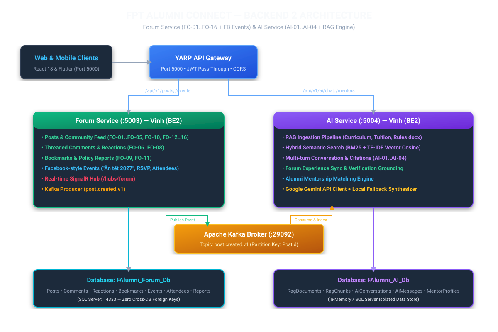
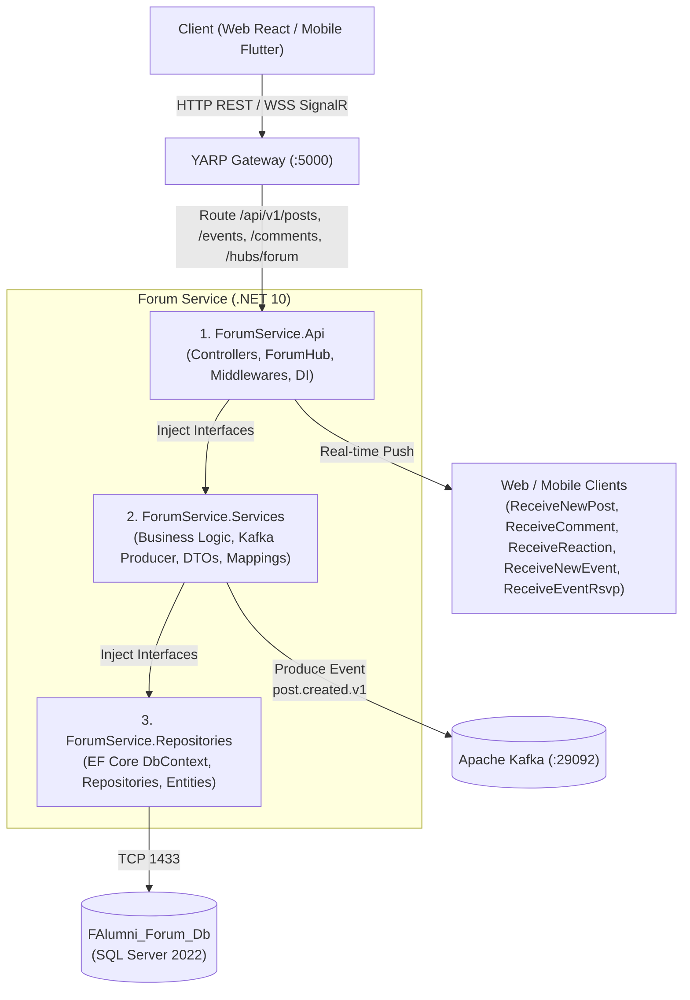
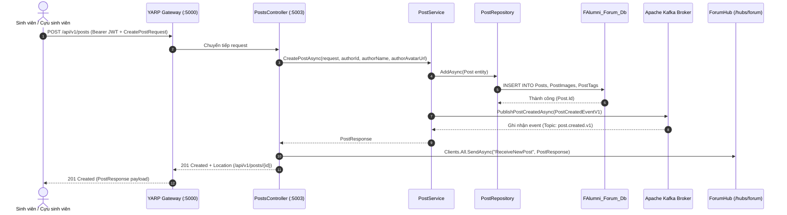
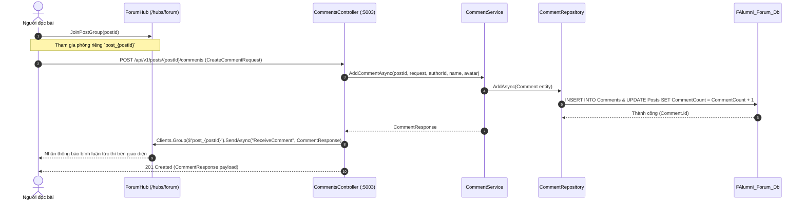

# 🏛️ Sơ Đồ Kiến Trúc Hệ Thống Chi Tiết — Forum Service (`f-alumni-forum-service`)

> **Người thực hiện**: Vinh (`vinhmt` — Backend 2)  
> **Cổng dịch vụ**: `http://localhost:5003` (HTTPS: `https://localhost:7003`)  
> **Kiến trúc**: 3 tầng chuẩn `.NET 10` (`Api -> Services -> Repositories`), SignalR Real-time Hub (`ForumHub`), Kafka Producer (`post.created.v1`).

---

## 1. Sơ Đồ Kiến Trúc Tổng Thể



---

## 2. Kiến Trúc 3 Tầng Phân Lập (Clean Layered Architecture)



---

## 3. Quy Trình Thời Gian Thực SignalR & Sự Kiện Bất Đồng Bộ Kafka

### 3.1 Luồng Đăng Bài Viết & Kafka Event Streaming (Sequence Diagram)


### 3.2 Luồng Bình Luận & Tương Tác Thời Gian Thực (Sequence Diagram)


### 3.3 Luồng Tạo Sự Kiện Mạng Xã Hội & Đăng Ký RSVP (Sequence Diagram)
```mermaid
sequenceDiagram
    autonumber
    actor Host as Người tạo sự kiện
    actor Guest as Người tham gia
    participant Hub as ForumHub (/hubs/forum)
    participant EventApi as EventsController (:5003)
    participant EventSvc as EventService
    participant DB as FAlumni_Forum_Db

    Host->>Hub: JoinEventsGroup()
    Guest->>Hub: JoinEventsGroup()
    Note over Host,Guest,Hub: Tham gia room `events_channel`

    Host->>EventApi: POST /api/v1/events (CreateEventRequest)
    EventApi->>EventSvc: CreateEventAsync(...)
    EventSvc->>DB: INSERT INTO Events, EventAttendees (Host auto Going)
    EventSvc-->>EventApi: EventResponse
    EventApi->>Hub: Clients.Group("events_channel").SendAsync("ReceiveNewEvent", EventResponse)
    Hub-->>Guest: Hiển thị sự kiện mới tức thì trên bảng sự kiện

    Guest->>EventApi: POST /api/v1/events/{id}/rsvp (Status: Going/Interested/NotGoing)
    EventApi->>EventSvc: RsvpEventAsync(...)
    EventSvc->>DB: Upsert EventAttendees & cập nhật GoingCount/InterestedCount
    EventApi->>Hub: Clients.Group("events_channel").SendAsync("ReceiveEventRsvp", payload)
    Hub-->>Host: Cập nhật số lượng người tham gia thời gian thực
```
