# 🗄️ Sơ Đồ ERD Cơ Sở Dữ Liệu — Forum Service (`FAlumni_Forum_Db`)

> **Service**: `f-alumni-forum-service`  
> **Người phụ trách**: Vinh (`vinhmt` — Backend 2)  
> **Cơ sở dữ liệu**: `FAlumni_Forum_Db` (SQL Server + EF Core 10)  
> **Nguyên tắc kiến trúc**: Database-per-Service — Độc lập 100%, không chia sẻ bảng hay khóa ngoại (Zero Cross-Database Foreign Keys) với các Microservices khác. Mọi quan hệ tới `UserId` đều lưu dưới dạng `uniqueidentifier` (`Guid`) độc lập.

---

## 1. Sơ Đồ ERD Chuẩn Mermaid (`FAlumni_Forum_Db`)

```mermaid
erDiagram
    Posts ||--o{ PostImages : "1:N (PostId, Cascade)"
    Posts ||--o{ PostTags : "1:N (PostId, Cascade)"
    Posts ||--o{ Comments : "1:N (PostId, Cascade)"
    Posts ||--o{ Reactions : "1:N (PostId, Cascade)"
    Posts ||--o{ Bookmarks : "1:N (PostId, Cascade)"
    Comments ||--o{ Comments : "1:N (ParentCommentId - Trả lời lồng nhau, Restrict)"
    Events ||--o{ EventAttendees : "1:N (EventId, Cascade)"

    Categories {
        uniqueidentifier Id PK "Guid.NewGuid()"
        nvarchar_150 Name "NOT NULL"
        nvarchar_150 Slug "NOT NULL, Unique Index"
        nvarchar_max Description "NOT NULL, Default empty"
        datetime2 CreatedAt "NOT NULL, Default UtcNow"
    }

    Posts {
        uniqueidentifier Id PK "Guid.NewGuid()"
        uniqueidentifier AuthorId "NOT NULL (Pure Guid, Index)"
        nvarchar_200 AuthorName "NOT NULL"
        nvarchar_max AuthorAvatarUrl "NOT NULL, Default empty"
        nvarchar_300 Title "NOT NULL"
        nvarchar_max Content "NOT NULL"
        nvarchar_50 PostType "NOT NULL, Index (Question | Sharing | Recruitment)"
        nvarchar_50 Major "NOT NULL, Index (SE | AI | IA | GD | IB | MC | MKT | All)"
        nvarchar_50 Campus "NOT NULL, Index (FU-HCM | FU-HL | FU-DN | FU-CT | FU-QN | All)"
        bit IsAnswered "NOT NULL, Index, Default 0 (FO-15, FO-16)"
        int ViewCount "NOT NULL, Default 0"
        int LikeCount "NOT NULL, Default 0"
        int CommentCount "NOT NULL, Default 0"
        bit IsPinned "NOT NULL, Default 0 (Ưu tiên hiển thị trên Feed)"
        bit IsHidden "NOT NULL, Default 0 (Trạng thái ẩn bài)"
        datetime2 CreatedAt "NOT NULL, Index, Default UtcNow"
        datetime2 UpdatedAt "NULL"
    }

    PostImages {
        uniqueidentifier Id PK "Guid.NewGuid()"
        uniqueidentifier PostId FK "NOT NULL -> Posts.Id"
        nvarchar_1000 ImageUrl "NOT NULL"
        int Order "NOT NULL, Default 0"
    }

    PostTags {
        uniqueidentifier Id PK "Guid.NewGuid()"
        uniqueidentifier PostId FK "NOT NULL -> Posts.Id"
        nvarchar_100 TagName "NOT NULL, Index"
    }

    Comments {
        uniqueidentifier Id PK "Guid.NewGuid()"
        uniqueidentifier PostId FK "NOT NULL, Index -> Posts.Id"
        uniqueidentifier AuthorId "NOT NULL (Pure Guid)"
        nvarchar_200 AuthorName "NOT NULL"
        nvarchar_max AuthorAvatarUrl "NOT NULL, Default empty"
        nvarchar_max Content "NOT NULL"
        uniqueidentifier ParentCommentId FK "NULL, Index -> Comments.Id (FO-07 Reply)"
        bit IsAcceptedAnswer "NOT NULL, Default 0 (FO-16)"
        datetime2 CreatedAt "NOT NULL, Default UtcNow"
        datetime2 UpdatedAt "NULL"
    }

    Reactions {
        uniqueidentifier Id PK "Guid.NewGuid()"
        uniqueidentifier PostId FK "NOT NULL -> Posts.Id"
        uniqueidentifier UserId "NOT NULL (Pure Guid)"
        nvarchar_30 ReactionType "NOT NULL, Default 'Like'"
        datetime2 CreatedAt "NOT NULL, Default UtcNow"
    }

    Bookmarks {
        uniqueidentifier Id PK "Guid.NewGuid()"
        uniqueidentifier PostId FK "NOT NULL -> Posts.Id"
        uniqueidentifier UserId "NOT NULL (Pure Guid)"
        datetime2 CreatedAt "NOT NULL, Default UtcNow"
    }

    Reports {
        uniqueidentifier Id PK "Guid.NewGuid()"
        nvarchar_30 TargetType "NOT NULL (Post | Comment)"
        uniqueidentifier TargetId "NOT NULL, Index"
        uniqueidentifier ReporterId "NOT NULL (Pure Guid)"
        nvarchar_max ReporterName "NOT NULL"
        nvarchar_200 Reason "NOT NULL"
        nvarchar_max Details "NULL"
        nvarchar_30 Status "NOT NULL, Default 'Pending' (Pending | Approved | Dismissed)"
        datetime2 CreatedAt "NOT NULL, Default UtcNow"
    }

    Events {
        uniqueidentifier Id PK "Guid.NewGuid()"
        uniqueidentifier CreatorId "NOT NULL (Pure Guid)"
        nvarchar_200 CreatorName "NOT NULL"
        nvarchar_max CreatorAvatarUrl "NOT NULL, Default empty"
        nvarchar_300 Title "NOT NULL"
        nvarchar_max Description "NOT NULL"
        nvarchar_max BannerUrl "NOT NULL, Default empty"
        nvarchar_300 Location "NOT NULL (Địa chỉ Offline hoặc Link Online)"
        nvarchar_50 Campus "NOT NULL, Index, Default 'All'"
        datetime2 StartTime "NOT NULL, Index"
        datetime2 EndTime "NOT NULL"
        int MaxAttendees "NULL"
        int GoingCount "NOT NULL, Default 0"
        int InterestedCount "NOT NULL, Default 0"
        datetime2 CreatedAt "NOT NULL, Default UtcNow"
    }

    EventAttendees {
        uniqueidentifier Id PK "Guid.NewGuid()"
        uniqueidentifier EventId FK "NOT NULL -> Events.Id"
        uniqueidentifier UserId "NOT NULL (Pure Guid)"
        nvarchar_200 UserName "NOT NULL"
        nvarchar_max UserAvatarUrl "NOT NULL, Default empty"
        nvarchar_30 Status "NOT NULL (Going | Interested | NotGoing)"
        datetime2 RegisteredAt "NOT NULL, Default UtcNow"
    }
```

---

## 2. Các Ràng Buộc Khóa & Chỉ Mục Nổi Bật (Indexes & Constraints)

1. **Unique Index (Chống trùng lặp tuyệt đối)**:
   - `Categories(Slug)`: Slug định danh URL danh mục là duy nhất.
   - `Reactions(PostId, UserId)`: Mỗi người dùng chỉ tương tác 1 trạng thái react trên 1 bài viết.
   - `Bookmarks(PostId, UserId)`: Mỗi người dùng chỉ lưu 1 bản bookmark trên 1 bài viết.
   - `EventAttendees(EventId, UserId)`: Mỗi người tham gia chỉ có 1 trạng thái RSVP duy nhất cho 1 sự kiện.
2. **Index Tối Ưu Hóa Truy Vấn & Lọc Feed (High-Performance Querying)**:
   - `Posts(AuthorId)`: Tối ưu tra cứu danh sách bài viết cá nhân (`/api/v1/posts/me`).
   - `Posts(Campus)`: Tối ưu lọc bảng tin theo cơ sở FPTU.
   - `Posts(Major)`: Tối ưu lọc bài viết theo khối chuyên ngành.
   - `Posts(PostType)`: Tối ưu lọc loại bài đăng (`Question`, `Sharing`, `Recruitment`).
   - `Posts(IsAnswered)`: Tối ưu lọc câu hỏi đã/chưa có lời giải đáp (FO-15, FO-16).
   - `Posts(CreatedAt)`: Tối ưu sắp xếp bảng tin mới nhất (`sort=latest`).
   - `PostTags(TagName)`: Tăng tốc độ tìm kiếm bài viết theo hashtag.
   - `Comments(PostId)`, `Comments(ParentCommentId)`: Tối ưu tải cây bình luận đa cấp.
   - `Reports(TargetId)`: Tăng tốc tra cứu các báo cáo vi phạm theo đối tượng.
   - `Events(Campus)`, `Events(StartTime)`: Tối ưu tìm kiếm và sắp xếp danh sách sự kiện sắp diễn ra.
